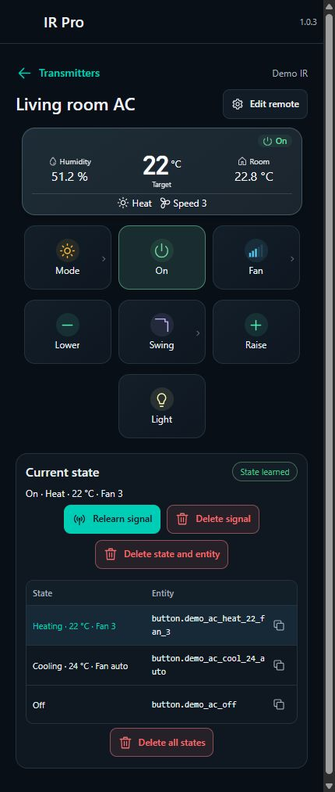
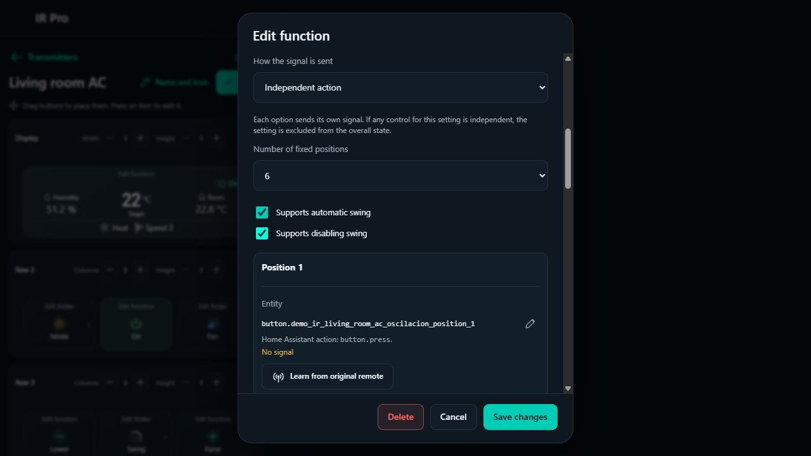
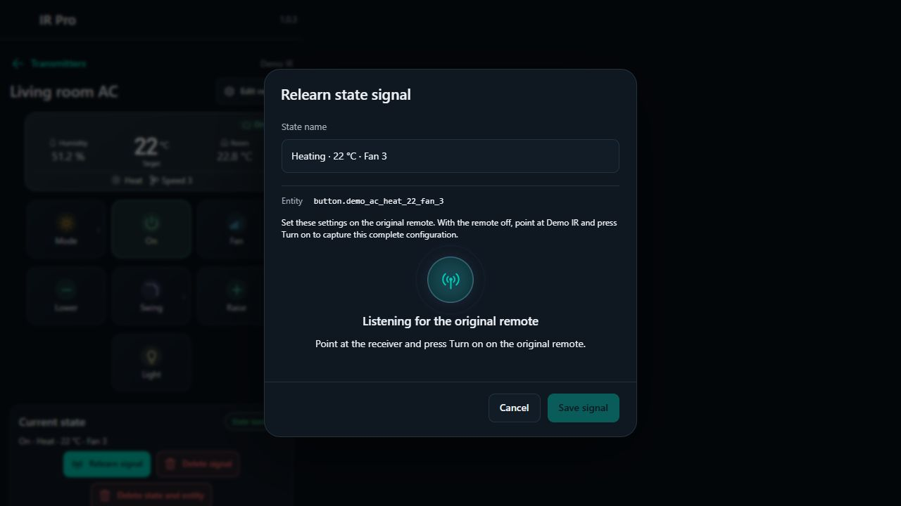
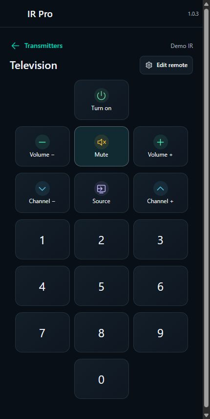

# IR Pro

**Crea mandos infrarrojos que funcionen como tu aparato.**

[English](../README.md) · [Español](README.es.md) · [Última versión estable](https://github.com/K320X/ir-pro/releases/latest)

IR Pro es un editor visual de mandos para Home Assistant. Permite aprender órdenes sencillas, grabar configuraciones completas de un aire acondicionado y combinar ambos comportamientos en un mismo mando. Los botones, las pantallas, las carpetas y sus entidades de Home Assistant se gestionan en un solo sitio.

*Mando de aire acondicionado con ajustes estimados y estados aprendidos. Las capturas muestran dispositivos y lecturas ficticios, con la interfaz en inglés; también está disponible en español.*

## El problema: una señal no siempre equivale a una sola acción

En algunos protocolos de aire acondicionado, una señal incluye modo, temperatura y ventilador a la vez. Si grabas **subir temperatura** cuando el mando indica **Calor · 24 °C · Ventilador 3**, al reproducirla puedes enviar esa combinación completa, aunque el split esté en frío. Cambiar el nombre de la grabación no cambia lo que contiene. La [implementación de LG en ESPHome](https://github.com/esphome/esphome/blob/dev/esphome/components/climate_ir_lg/climate_ir_lg.cpp) muestra mensajes combinados, órdenes independientes de oscilación y mensajes de encendido distintos.

Una lista de códigos aprendidos puede resultar confusa si todos se presentan como pulsaciones simples. Crear un script o un botón para cada combinación también genera una lista cada vez mayor que mantener. Una integración de climatización específica puede generar las combinaciones admitidas, pero necesita un protocolo compatible con el aparato; [ESPHome documenta sus plataformas de climatización por IR](https://esphome.io/components/climate/climate_ir/).

IR Pro permite definir qué hace realmente cada orden:

| Qué hace la señal física | Cómo se configura | Qué envía IR Pro |
| --- | --- | --- |
| Una acción independiente, como silenciar o encender la luz | Botón aprendido o **Acción independiente** | Su propia señal grabada |
| Varios ajustes a la vez, como encendido, modo, temperatura y ventilador | **Ajustes del mando** | La grabación que corresponde a esa combinación |
| Algunos ajustes combinados y otros por separado | Ambos comportamientos dentro del mismo mando | Un estado para los ajustes vinculados y señales propias para los independientes |

Por ejemplo, puedes vincular modo, temperatura, ventilador y encendido a los **Ajustes del mando**, dejando oscilación y luz como **Acciones independientes**. La oscilación usa entonces su propia orden y queda fuera del nombre y la búsqueda del estado combinado. No necesitas multiplicar las grabaciones completas por cada posición de oscilación.

**IR Pro organiza y reproduce las señales que le enseñas. No descodifica protocolos desconocidos ni inventa combinaciones que no hayas aprendido.** Puedes grabar las combinaciones que necesites. Si falta la señal correspondiente, no envía otra como sustitución.

## Un mando editable para cada uso

*Cada control puede formar parte de los ajustes combinados o aprender una señal independiente.*

- **Botones:** envían una señal aprendida o modifican un ajuste vinculado.
- **Botones de doble acción:** reúnen dos acciones en una tarjeta, cada una con su nombre, icono y color. Un par de señales aprendidas de encendido y apagado se expone como un único interruptor de Home Assistant.
- **Carpetas:** despliegan modos, velocidades, posiciones de oscilación o controles propios. Puedes configurar de dos a cinco velocidades, ventilador automático opcional, hasta seis posiciones fijas, oscilación y desactivado.
- **Pantallas:** muestran los ajustes estimados y permiten adaptar su tamaño. Si el dispositivo de Home Assistant del emisor publica temperatura o humedad, aparecen también sus lecturas disponibles como mediciones de ambiente. Si no hay una lectura válida, se omite.
- **Diseños iniciales:** proporcionan mandos de aire acondicionado y televisión que puedes modificar o eliminar. Solo se aplican al crear el dispositivo; cambiar después su icono no reemplaza sus controles.

La interfaz sigue el idioma del usuario de Home Assistant. Está disponible en **español e inglés**, con inglés como alternativa para los idiomas aún no traducidos. Los números se adaptan al idioma. Tus nombres, etiquetas e identificadores de entidad no se traducen ni se renombran automáticamente.

### Aprender un estado completo

1. Prepara la combinación en IR Pro, por ejemplo **Calor · 24 °C · Ventilador 3**, y configura lo mismo en el mando original.
2. Pulsa **Aprender estado**. El nombre sugerido se puede modificar.
3. Para grabar un estado de encendido, empieza con el mando original apagado, apunta al Broadlink y pulsa **Encender** con los ajustes previstos. Para el estado apagado, pulsa **Apagar**. Una tecla de temperatura o ventilador puede no incluir la orden de encendido.
4. Guarda cuando llegue la señal. Probarla es opcional.
5. El estado aparece en la tabla junto con su entidad real de tipo `button`. Copia su identificador para utilizarlo en automatizaciones o scripts.

*Prepara el mando original, inicia la escucha y captura la orden exacta para esos ajustes.*

**Apagado es un único estado.** No necesitas una grabación de apagado por cada temperatura, modo o velocidad. Preparar otros ajustes mientras el mando está apagado no enciende el aparato.

La acción **Enviar señal de ajustes del mando** reenvía la grabación que corresponde a los ajustes actuales, sin modificarlos antes. Está disponible en un botón, en cualquiera de las dos acciones de un botón doble o en un botón de una carpeta personalizada. Respeta los ajustes independientes y utiliza la grabación de apagado cuando corresponde. Si no hay un estado aprendido que coincida, no transmite IR.

Las órdenes independientes se aprenden en el editor de su función o carpeta. Tienen sus propias señales y entidades, y no generan filas en la tabla de estados completos. Tras un envío correcto, solo se actualiza su ajuste declarado en la pantalla estimada. Esto también permite configurar encendido o temperatura como independientes cuando el protocolo físico funciona así.

Cada grabación conserva los campos que controla. Si conviertes una carpeta en independiente, una grabación antigua más amplia no se reutiliza con otro significado: IR Pro solo envía estados cuyo conjunto de campos coincide con la configuración actual. Si todos los ajustes son independientes, no hay un estado combinado que aprender.

### El mando de televisión sigue siendo sencillo

*El diseño de televisión utiliza órdenes individuales y no muestra el panel de estados de un aire acondicionado.*

Al elegir el icono de televisión se crea una disposición de tres columnas con botones de altura mínima: encendido/apagado de doble acción, volumen, silencio, canales, entrada y números del 1 al 9, con el 0 centrado debajo. Los dos iconos de aire acondicionado crean el mismo diseño con pantalla y carpetas configurables. Todos los controles iniciales se pueden editar, sustituir o eliminar.

## Instalación con HACS

Necesitas Home Assistant **2026.10 o posterior**, HACS y un mando Broadlink compatible ya configurado en Home Assistant.

1. Abre **HACS → menú → Repositorios personalizados**.
2. Añade `https://github.com/K320X/ir-pro` como tipo **Integración**.
3. Busca **IR Pro** y descarga la última versión estable.
4. Reinicia Home Assistant.
5. Entra en **Ajustes → Dispositivos y servicios → Añadir integración → IR Pro**.
6. Abre **IR Pro** en la barra lateral y pulsa **Añadir emisor**.

IR Pro utiliza las [acciones de aprendizaje y envío de Broadlink](https://www.home-assistant.io/integrations/broadlink/#remote). Configura primero el emisor físico mediante esa integración. IR Pro no requiere YAML, tokens del navegador ni una cuenta del fabricante; para conectar un Broadlink nuevo a la red puede ser necesaria la aplicación del fabricante.

El repositorio se instala como repositorio personalizado de HACS y todavía no forma parte de su catálogo predeterminado. IR Pro empieza vacío: no importa los mandos de ejemplo de estas imágenes.

## Editar, aprender y automatizar

1. Añade un emisor reconocido y crea un dispositivo con nombre e icono.
2. Entra en **Editar mando** para modificar el diseño inicial o añadir funciones.
3. Para una acción aprendida sencilla, pulsa **Aprender del mando original**, apunta al Broadlink y pulsa la tecla que quieras grabar.
4. Tras recibirla, pulsa **Guardar cambios**. **Probar señal** es opcional y solo transmite cuando lo seleccionas.
5. Utiliza la entidad de la función o del estado aprendido en las automatizaciones y scripts de Home Assistant.

Un botón doble con dos señales aprendidas utiliza **una sola entidad `switch`**. `switch.turn_on` ejecuta la acción 1 y `switch.turn_off`, la acción 2, ambas sobre la misma entidad. Cada llamada envía su señal una vez: el interruptor no transmite continuamente. Su estado es estimado. Un botón doble también puede combinar un ajuste del mando con una acción aprendida; esa acción aprendida tiene su propia entidad `button`.

El lápiz situado junto a **Entidad** permite editar su identificador. El dominio (`button.` o `switch.`) se mantiene. Un cambio confirmado conserva su identidad y sus señales; revisa las automatizaciones, scripts y paneles que utilicen el identificador antiguo.

Los controles que vienen en un diseño inicial también se pueden modificar. Los cambios de aspecto conservan entidades y grabaciones. Si cambiar el tipo de función o el significado de una orden exige sustituirla, el editor muestra las entidades afectadas antes de guardar. Las funciones de sustitución deben aprender sus propias señales. Cancelar conserva el mando guardado.

La configuración se almacena en Home Assistant, no en el almacenamiento del navegador. El emisor se identifica mediante referencias estables del registro de entidades. Cambiar el nombre de un mando o una función no renombra automáticamente sus entidades.

## Compatibilidad y límites reales

- **Broadlink:** actualmente se aprende y transmite mediante sus entidades `remote`. Otros adaptadores IR aún no están admitidos.
- **Estado estimado:** el envío IR habitual no confirma la recepción. La pantalla refleja los ajustes estimados de IR Pro, no una medición del aparato. Usar el mando original fuera de una sesión de aprendizaje no sincroniza IR Pro automáticamente. Esta limitación también existe en el [control de climatización IR sin un receptor compatible](https://esphome.io/components/climate/climate_ir/).
- **Combinaciones aprendidas:** cada estado completo que quieras utilizar debe capturarse con el mando original. No hay una base universal de protocolos, descodificación automática ni una entidad `climate` generada automáticamente.
- **Envíos explícitos:** cargar, guardar, duplicar o reiniciar no envía señales por sí solo. Una captura se puede guardar al recibirla. IR Pro comprueba el comando almacenado en Broadlink con cero repeticiones, sin emitir IR; la prueba física sigue siendo opcional.
- **Sensores de ambiente:** temperatura y humedad se detectan en el dispositivo de Home Assistant del emisor. No dependen de nombres de entidad fijados a mano ni seleccionan cualquier termómetro de la habitación. Solo aparecen las lecturas disponibles.
- **Copias:** duplicar conserva la distribución y el aspecto. En el mismo emisor se pueden reutilizar las señales; en otro deben aprenderse allí, porque los códigos almacenados en Broadlink no se transfieren. Los mandos existentes no se trasladan entre emisores.
- **Eliminación:** borrar una función o un mando elimina sus datos y entidades de IR Pro. Revisa las automatizaciones que los usen. La integración física de Broadlink y sus códigos aprendidos permanecen. **Borrar todos los estados** elimina solo las grabaciones combinadas y sus entidades, conservando el diseño y las acciones independientes.
- **Acceso:** el panel de gestión requiere permisos de administrador. El uso normal de las entidades sigue los permisos de Home Assistant.

## Actualizaciones y recuperación

Haz una copia de seguridad de Home Assistant antes de instalar o actualizar una integración personalizada. Los metadatos de IR Pro se incluyen en las copias normales de configuración. Las órdenes aprendidas se guardan en la integración Broadlink. No edites manualmente los archivos `.storage` de ninguna de las dos.

1. Instala una versión estable etiquetada mediante HACS. Activa las versiones preliminares solo si quieres probarlas expresamente.
2. Cuando aparezca en **Ajustes → Sistema → Actualizaciones**, selecciona IR Pro e instala la actualización. También puedes hacerlo desde su página en HACS.
3. Reinicia Home Assistant y recarga el navegador o la aplicación para cargar los archivos nuevos del panel.
4. Comprueba tus mandos y entidades. Si aún no aparece la versión, utiliza **Actualizar información** en el menú del repositorio en HACS.

Las actualizaciones conservan los mandos, señales e identificadores existentes. HACS comprueba las versiones periódicamente, por lo que una publicación puede tardar en aparecer. La actualización descarga archivos mediante HACS; no ejecuta directamente una versión desde GitHub.

Para desinstalar, elimina la entrada de integración de IR Pro, desinstálala en HACS y reinicia Home Assistant. Los dispositivos Broadlink y los scripts ajenos permanecen. Desinstalar no purga los metadatos guardados de IR Pro, por lo que reinstalar puede recuperarlos. Si quieres descartarlos, elimina antes los mandos desde el panel.

## Desarrollo y licencia

Los comandos de desarrollo y comprobación están en el [README en inglés](../README.md#development). GitHub Actions ejecuta las pruebas, las comprobaciones del frontend, la validación de HACS y Hassfest. El comportamiento infrarrojo físico requiere pruebas con hardware real.

Licencia MIT. IR Pro es un proyecto comunitario independiente para Home Assistant.
